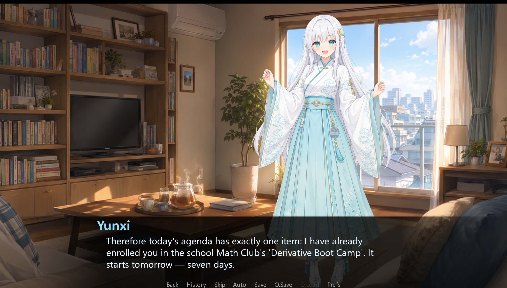
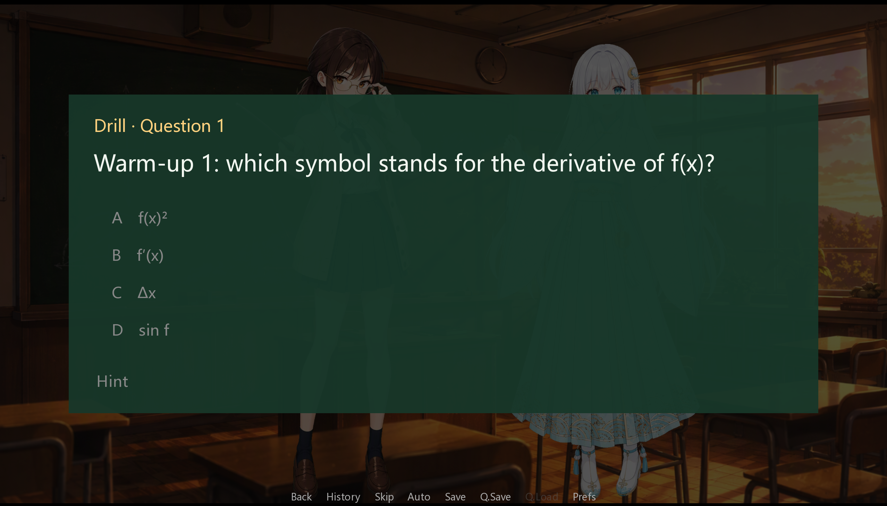

# 导数物语 (DERIVATIVE STORY)

> **“在函数的极限处，遇见关于你的解。”**  
> 一款结合高中微积分（导数）学习与选择支恋爱的视觉小说（galgame），基于 **Ren'Py 8.5.3** 引擎制作。

> **"At the limit of the function, I found the solution to you."**  
> A visual novel (galgame) combining high school calculus (derivatives) learning with choice-driven romance, built on the **Ren'Py 8.5.3** engine.

---

---
##  游戏简介 / Game Introduction

玩家将扮演一名面临高考/期末挑战的高中生，在上完 7 节“导数课”的过程中，与两位性格迥异的女主角展开故事：
- **云曦**：古风白发少女，神秘地“附身”在黑板与数学公式之间。
- **苏知微**：严谨的眼镜社长，冷静理智的数学学霸。

在解题、上课与课后约会中积累经验与好感度，你的选择与答题表现将决定走向 **云曦线**、**社长线** 或 **中立线**。

Players will take on the role of a high school student facing college entrance exams or final challenges. Over the course of 7 "Calculus Lessons," you will interact with two heroines of contrasting personalities:
- **Yun Xi**: A classical white-haired girl who mysteriously "possesses" the blackboard and mathematical formulas.
- **Su Zhiwei**: A rigorous, bespectacled club president and calm, rational math prodigy.
- 
By solving problems, attending classes, and going on after-school dates, you will accumulate experience and affection points. Your choices and quiz performance will determine whether you branch into the Yun Xi route, the Club President route, or a neutral ending.

---

---
##  快速开始与运行指南 / Quick Start & Running Guide

### 1. 安装 Ren'Py 引擎 / Install Ren'Py Engine
本游戏基于 **Ren'Py 8.5.3** 开发。请根据你的操作系统下载并安装 SDK：
This game is developed based on **Ren'Py 8.5.3**. Please download and install the SDK according to your operating system:

1. 前往 [Ren'Py 官方下载页面](https://www.renpy.org/latest.html)。 / Go to the [Ren'Py Official Download Page](https://www.renpy.org/latest.html).
2. 下载适用于你系统（Windows / macOS / Linux）的 **Ren'Py SDK 8.x** 版本并解压安装。 / Download and extract the **Ren'Py SDK 8.x** version for your system (Windows / macOS / Linux).

### 2. 运行游戏 / Running the Game
有以下两种运行方式： / There are two ways to run the game:

#### 方式 A：通过 Ren'Py SDK 启动（推荐） / Method A: Launch via Ren'Py SDK (Recommended)
1. 打开 Ren'Py SDK 启动器。 / Open the Ren'Py SDK launcher.
2. 点击 **“Preferences” -> “Projects Directory”**，将本项目的根目录 `galgame-math/` 所在的文件夹添加进来。 / Click **"Preferences" -> "Projects Directory"** and add the folder containing this project's root directory `galgame-math/`.
3. 在左侧项目列表中选择 **`galgame-math`**，点击 **“Launch Project”（启动项目）** 即可。 / Select **`galgame-math`** from the project list on the left and click **"Launch Project"**.

#### 方式 B：直接启动可执行文件 / Method B: Direct Executable Launch
如果你使用的是打包好的游戏版本，直接点击 `/game/` 同级目录下的项目启动程序（或点击 `/game/` 内部的主脚本入口）即可运行。
If you are using a packaged game version, simply click the project launcher in the same directory as `/game/` (or click the main script entry inside `/game/`) to run.

---

##  项目目录结构 / Project Directory Structure

```text
galgame-math/
├── game/                          ← 游戏核心逻辑与全部资源 / Core logic & all assets
│   ├── script.rpy                 ← 主流程控制 (start -> prologue -> lesson1..7 -> finale -> epilogue)
│   ├── math_core.rpy              ★ 做题引擎：题库切片、判题逻辑、MC/IN 答题界面、practice() / Quiz engine: question slicing, grading logic, UI, etc.
│   ├── love.rpy                   ★ 恋爱系统：好感度管理 (love_yx/love_zw)、相册与 CG 回放 / Romance system: affection mgmt, gallery & CG replay
│   ├── prelude.rpy                ← 每课前置小剧情与题型讲解 / Pre-lesson mini-stories & topic explanations
│   ├── defines.rpy                ← 角色立绘定义、全局变量与好感度初始化 / Character sprite definitions, globals & affection init
│   ├── options.rpy                ← 基础配置（分辨率、主菜单音乐、音量静音逻辑） / Basic config (resolution, BGM, volume/mute logic)
│   ├── screens.rpy                ← UI 界面定义（主菜单、设置、答题 UI、静音开关） / UI definitions (main menu, settings, quiz UI, mute toggle)
│   ├── title_fx.rpy               ← 主菜单 Visual 效果（鼠标视差、粒子浮尘等 ATL 变换） / Main menu visual effects (parallax, dust particles, ATL)
│   ├── i18n.rpy                   ← 多语言国际化辅助 / Localization support
│   ├── gui.rpy / guisupport.rpy   ← Ren'Py 默认 GUI 框架支持文件 / Ren'Py default GUI framework support files
│   │
│   ├── lessons/                   ← 7 节课对应题库 / Question banks for the 7 lessons
│   │   ├── lN_xxx.rpy             ← 中文题目与解析 (Lesson 1 ~ 7) / Chinese questions & explanations
│   │   └── lN_en.rpy              ← 英文题库支持 / English question bank support
│   │
│   ├── scenes/                    ← 剧情文本拆分 / Split story texts
│   │   ├── tutorial.rpy           ← 开局教学 / Opening tutorial
│   │   ├── dates.rpy              ← 4 段角色约会剧情 / 4 character dating scenarios
│   │   ├── sides.rpy              ← 课后日常小插曲 / After-school daily vignettes
│   │   ├── interlude.rpy          ← 6 段转场间幕 / 6 transition interludes
│   │   └── ending.rpy             ← 三线结局 + 第二部预告 / Three-route endings + Part 2 teaser
│   │
│   ├── audio/                     ← 音效与 BGM（含 6 首 .ogg 主题音乐） / SFX & BGM (including 6 .ogg theme tracks)
│   ├── images/                    ← 游戏美术资源 / Game art assets
│   │   ├── characters/            ← 角色立绘 / Character sprites
│   │   ├── backgrounds/            ← 场景背景 / Scene backgrounds
│   │   ├── blackboard/             ← 黑板板书与数学图表 / Blackboard notes & math charts
│   │   ├── story/                  ← 剧情 CG (scg1 ~ scg9) / Story CGs
│   │   └── memories/               ← 回忆相册照片 (mem1 ~ mem11) / Memory album photos
│   └── fonts/                     ← 游戏字体文件（包含中文黑体） / Game font files (includes Chinese Sans-serif)


（此项目图片由千问3.8生成，代码+对话是在ai辅助下写出）
```
